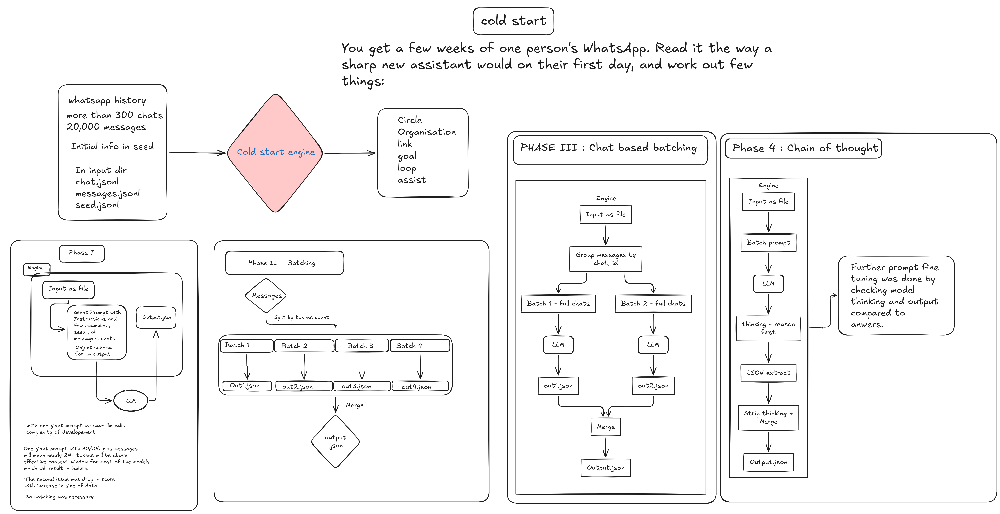

# Cold Start — Xpert Challenge

Extract people, organizations, goals, and open loops from a WhatsApp history — the way a sharp new assistant would on day one.

## Quick Start

```bash
# Set environment variables
export LLM_BASE_URL=https://openrouter.ai/api/v1
export LLM_API_KEY=your_key_here
export LLM_MODEL=deepseek/deepseek-v4.1-flash-1017

# Run
./run.sh <input_dir> output.json
```

The input directory must contain `chats.jsonl`, `messages.jsonl`, and `seed.json`.

## Architecture



The engine evolved through 5 phases:

**Phase I — Giant Prompt:** All messages in one call. Simple but exceeds context windows at scale.

**Phase II — Token Batching:** Split by token count. Fits context window but breaks conversations mid-thread.

**Phase III — Chat-Based Batching:** Group by `chat_id` first, then pack into batches. Full conversations stay intact. Dev set (4502 msgs) fits in 1 batch; hidden set uses ~3.

**Phase IV — Chain of Thought:** Model reasons inside `<thinking>` tags before outputting JSON. Significantly improves relationship inference and loop detection.

**Phase V — Prompt Tuning:** Explicit rules for every scoring dimension — circle definitions, org consolidation, loop scope, source_msg selection, help action guidelines. Score: 22.4/56 dev vs 17.5 baseline.

## Output

One `output.json` per run with five sections:

| Field | What it contains |
|-------|-----------------|
| `people` | Circle + org links for every person |
| `organisations` | Companies, home, properties ME belongs to |
| `chats` | Each chat tied to a person or org |
| `goals` | Up to 10 goals with evidence messages |
| `open_loops` | Tasks in motion with status + help action |

## Model

`deepseek/deepseek-v4.1-flash-1017` via OpenRouter — 1M context window, ~$0.035/$0.50 per 1M tokens (~0.25× baseline cost).

## Scores (dev set, 56 points available)

| Part | Score |
|------|-------|
| Circles | 7.9 / 12 |
| Organisations | 1.6 / 8 |
| Chats | 7.2 / 8 |
| Loops found | 2.9 / 14 |
| Loops status | 3.0 / 14 |
| **Total** | **22.7 / 56** |

Baseline: 17.5 / 56

## Repo Structure

```
run.sh              # Entry point
src/
├── main.ts         # CLI + config
├── extract/        # Core pipeline
│   ├── prompts.ts  # System prompt (all rules)
│   ├── batch-by-chat.ts
│   ├── extract-cot.ts
│   ├── merge.ts
│   └── post-process.ts
├── llm/            # OpenAI-compatible client with retry
├── io/             # File I/O
└── types/          # Zod schemas
WRITEUP.md          # Approach, cost, failure modes
ai-logs/            # Development session logs
docs/               # Architecture diagrams, design notes
```

See [WRITEUP.md](WRITEUP.md) for approach details and known failure modes.
